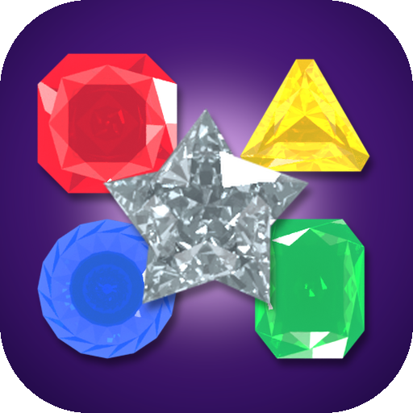
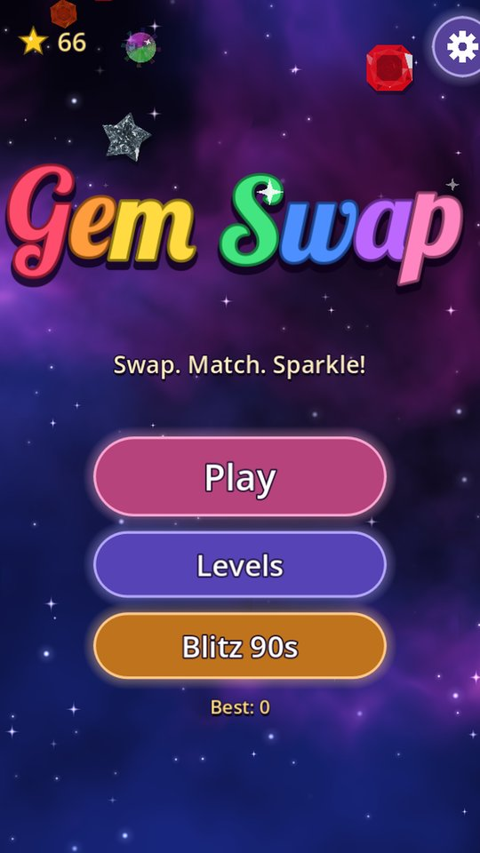
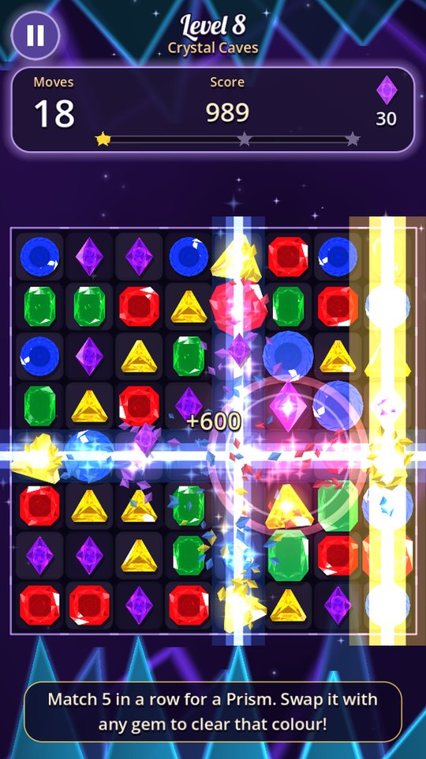
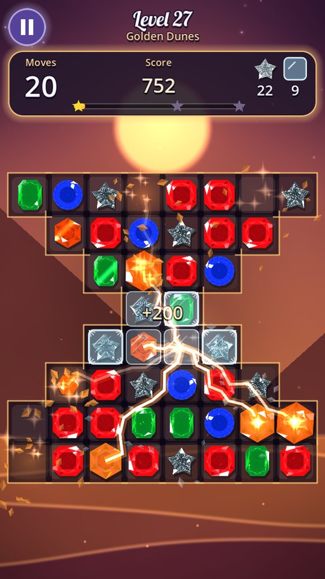
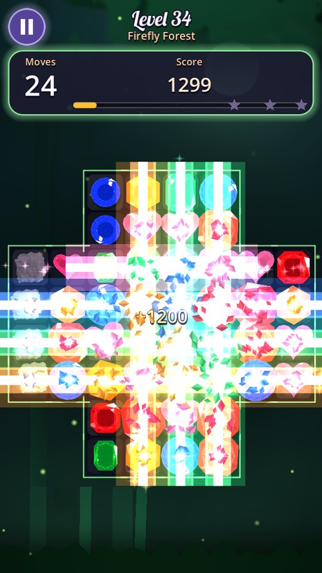

<div align="center">



# Gem Swap

**A sparkling match-3 puzzle made in Godot 4. Play in the browser, on Android or on Windows.**

**[▶ Play online](https://maxims.top/gems/)** · [Google Play](https://play.google.com/store/apps/details?id=com.maxsoft.bejeweled) · [Android APK](https://github.com/msveshnikov/gem-swap/releases/latest/download/GemSwap.apk) · [Windows exe](https://github.com/msveshnikov/gem-swap/releases/latest/download/GemSwap.exe)

   

</div>

## The game

Swipe a gem (or tap two neighbours) to swap them and line up three or more of a kind.

- **8 cut gems**, each with its own shape: ruby, fire topaz, citrine, emerald, sapphire, amethyst, star diamond, rose heart.
- **Special gems:** 4 in a row → **Line gem** (clears a row or column), an L or T → **Bomb**, 5 in a row → rainbow **Prism**
  (swap it with any gem to clear that colour).
- **Combos:** swap two specials together — line + line = cross, line + bomb = triple cross, bomb + bomb = mega blast,
  prism + special = every gem of that colour becomes a special, prism + prism = the whole board.
- **60 levels in 6 animated worlds** (Crystal Caves, Sunken Temple, Golden Dunes, Firefly Forest, Fire Forge, Star Crown)
  with goals: score, collect gems, break ice, smash stone blocks. Then endless bonus levels.
- **Blitz:** 90 seconds, as many points as you can.
- Leftover moves turn into a fireworks bonus at the end of a level. Hints after a few idle seconds, auto-shuffle when stuck.

## Run locally

Godot 4.7 (Compatibility renderer). Open the folder in Godot and press Play, or:

```
godot --path .
godot --path . -- --level 12      # jump to a level
godot --path . -- --autotest      # self-test, screenshots in renders/game/
```

## How it's made

- Gems are rendered in Blender Cycles by [`blender/scripts/render_gems.py`](blender/scripts/render_gems.py), each in
  8 light angles so they glint in the game.
- Rules: [`scripts/match3.gd`](scripts/match3.gd); animations: [`scripts/board.gd`](scripts/board.gd), [`scripts/fx.gd`](scripts/fx.gd);
  world backdrops are one procedural shader, [`shaders/background.gdshader`](shaders/background.gdshader).
- Levels: [`tools/gen_levels.py`](tools/gen_levels.py), then an autoplayer tunes move counts and star scores (`-- --calibrate`).
- Sounds and music are CC0 (see [assets/CREDITS.md](assets/CREDITS.md)); the crystal chimes are synthesized by
  [`tools/make_chimes.py`](tools/make_chimes.py).

Building, testing and deploying: [AGENTS.md](AGENTS.md). Design decisions: [decisions.md](decisions.md).
